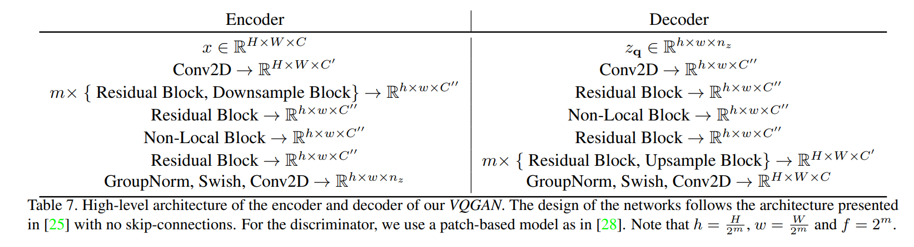
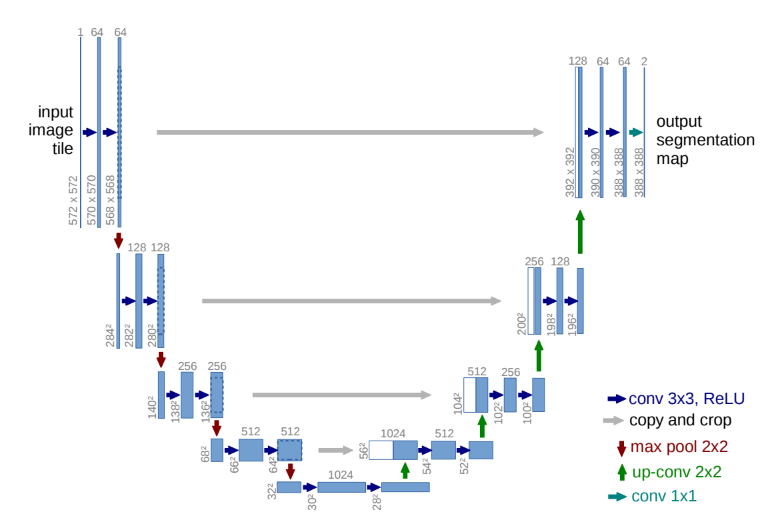
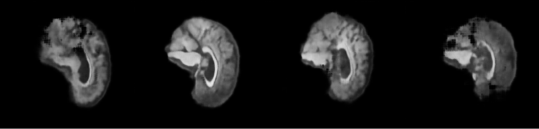
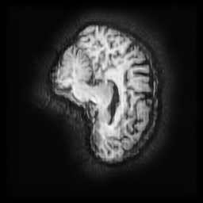
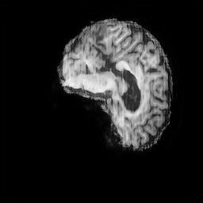
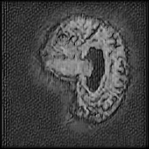
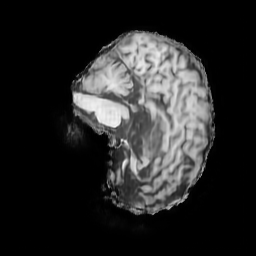
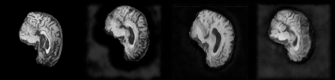
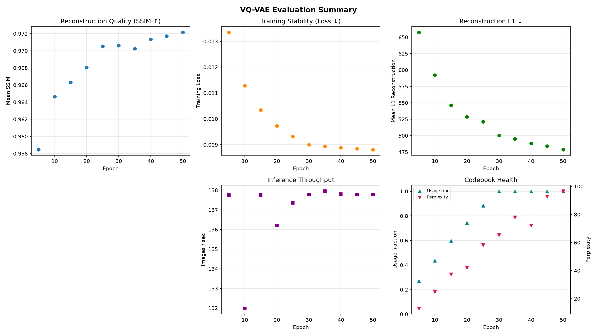

# Stable Diffusion trained on ADNI Brain MRI Dataset

This project aims to train a generative image model to produce synthetic BRAIN-MRI images without simply memorizing the training dataset. This project emphasises anonymity of the patients for which the training dataset was made and so a major portion of this project is detection of memorization of training data by the model.

# The Algorithm: Stable Diffusion

Stable Diffusion is an averarching term covering many different architectures. For this particular task I trained a Latent Diffusion model. This model consists of two major components, the VAE and the Denoising UNET. [(Rombach et al., 2022)](https://arxiv.org/pdf/2112.10752)

The above architecture diagram was taken directly from the paper. For this implementation we will disregard the transformer-based conditioning. Below is the architecture diagram of the VQVAE taken from the referenced paper [(Esser et al., CVPR 2021)](https://arxiv.org/pdf/2012.09841)

The Denoising UNET Architecture was adapted from assignment 2 with the addition of some Attention layers within the bottneck portion of the model which is consistent with modern UNET implementations.

[(Ronneberger et al, 2015)](https://arxiv.org/pdf/1505.04597)

The Stable Diffusion model works by first encoding the image into latent space via a pretrained VQVAE. The UNET is then trained to predict the added noise to an image for a certain step. For this implementation I utilized a linear nosing schedule. Once the UNET and VQVAE are finished training, the encoder can be disgarded and only the unet and decoder utilized to generate images. This happens by first sampling from the multivariate gaussian, iteratively predicting the added noise, and then numerically integrating along the denosing trajectory for a predefined number of timesteps to recover the image. 

# Preprocessing
The dataset used was the ADNI Brain MRI dataset. The dataloader supplied in dataset.py incorporates basic image rescaling and greyscale conversion for data preprocessing as this was found to be sufficient.

# Proposal and Feasibility Review

## User Need, Scope & Acceptance Criteria

The proposed research dilemma details a problem in curation of clinical datasets for open research. These datasets are typically sparse due to problems in patient confidentiality which limit the available, legally accessible data. A potential solution to this problem is to generate synthetic training examples. However, certain methods such as VAE typically generate poor and/or blurry images, leaving room for a better model that can generate high fidelity images whilst respecting patent confidentiality. 

The typical users of such a solution are medical students and researchers. These uses require the following:
- Anatomical representations are not blurry 
- The generated images do not hallucinate physiologically impossible tissue junctions or non-existant pathologies
- The model doesn't memorize patient scans from the dataset verbatim

To judge the perfomance of the solution against the above user requirements, the following acceptance criteria has been decided:
- A large number of samples will be generated and used to evaluate:
    - Visually inspect each image and compare it to the patient dataset. This will be a visual comparison to assess blurriness and physiological accuracy
    - For determining whether the generative model memorizes training data, the sample will be evaluated against the training and test datasets using the Mann–Whitney U test. This is a test for whether two datasets come from the same distribution. This test will generate p-values for both datasets and if the likelihood is higher for the test set than the training set then we can say the generative model likely didn't memorize the training data.

## Model Choice & Course Concepts

For this project I have chosen stable diffusion model as it has become (close to) the SOTA for generating crisp images in various domains. To successfully complete this task the following course concepts will be used:
- VQVAE and diffusion theory from lectures
- Best practices when writing code that runs on a HPC cluster

## Preliminary Feasibility Evidence

I have created and trained a VQVAE model on Rangpur already which has achieved good results on the ADNI dataset. 

## Risks, Budget and Fallback

Risks
- The diffusion model proves too difficult or time consuming to train
    - *Fallback*: Since the diffusion model has A VQ-VAE as an integral component, worst case I can submit the VQ-VAE as my project instead
- Rangpur cluster gets too busy to be able to train the model
    - *Mitigation*: I have budgeted significant enough time to this project to allow me to train the model earlier during the project period. This should give me enough time to avoid the rush.

Budget:
The latent diffusion model gave significant speed boosts to the generative modeling training community. The paper notes that training on imagenet using an A100 GPU took roughly 6.66hrs/epoch (VQVAE) for which they trained the model for roughly 2M steps taking around 1-2weeks of gpu training time. Considering this data and the relavtive size of ADNI (10,400 images) versus imagenet (1,281,167 images 1,000 classes) the time to train should be significantly smaller 10400/1281167 = 0.8% ~4hrs (conservatively) for training the diffusion portion of the model and from abalation ~3hrs to train the VQVAE portion. 

Total estimated training time for a full run ~7hrs.

# Requirements
This project was created using python version (3.14<=). The required packages are:
- Matplotlib
- Pytorch 
- Argparse/pathlib

# The Open Research Dilemma
The baseline model for these experiements is a standard VAE. For both the VAE and VQ-VAE/Diffusion, the models were evaluated using the following statistics:
- SSIM of reconstruction (against test dataset)
- Reconstruction loss
- Meehan Three Sample non-parametric test for data copying

The Meehan test was chosen especially because it is a well-used statistic used to determine whether a generative model generalizes to the test distribution or appears to 'copy' the training dataset. 

Two variants of the Diffusion/VQ-VAE were trained, the first one had no laplacian sharpness loss applied and produced relatively blurry images as will be discussed in the qualitative evaluation section. Hence, experiemnts were conducted to evaluate whether adding a laplacian sharness penalty to the VQ-VAE training would benefit the model.

The results for the baseline VAE and VQ-VAE/Diffusion models are shown below:

| Epoch | Recon SSIM | Recon L1 | KL | Gen SSIM | Z_U | p_copy | verdict | img/s |
| :--- | :--- | :--- | :--- | :--- | :--- | :--- | :--- | :--- |
| 5 | 0.7702 | 2241.9449 | 56.5384 | 0.7566 | -18.463 | 2.038e-76 | copying | 880.5 |
| 10 | 0.7772 | 2189.0043 | 54.8713 | 0.7615 | -17.377 | 6.149e-68 | copying | 797.0 |
| 15 | 0.7820 | 2148.9950 | 51.7609 | 0.7649 | -16.177 | 3.660e-59 | copying | 770.6 |
| 20 | 0.7843 | 2133.1342 | 56.0864 | 0.7660 | -16.900 | 2.245e-64 | copying | 837.6 |
| 25 | 0.7848 | 2129.3709 | 55.4599 | 0.7669 | -16.349 | 2.200e-60 | copying | 800.2 |
| 30 | 0.7858 | 2133.7020 | 56.0692 | 0.7682 | -17.790 | 4.263e-71 | copying | 862.0 |
| 35 | 0.7845 | 2166.9725 | 54.1305 | 0.7671 | -17.730 | 1.231e-70 | copying | 843.5 |
| 40 | 0.7852 | 2156.0094 | 55.6318 | 0.7673 | -17.689 | 2.555e-70 | copying | 884.9 |
| 45 | 0.7855 | 2148.4926 | 54.8829 | 0.7671 | -18.253 | 9.830e-75 | copying | 728.0 |
| 50 | 0.7850 | 2161.9264 | 54.1853 | 0.7681 | -17.820 | 2.456e-71 | copying | 836.1 |

*Table 1: VAE Evaluation results per given epoch*

| Epoch | Recon SSIM | Recon L1 | img/s |
| :--- | :--- | :--- | :---  |
| 5 | 0.9585 | 657.4826 | 137.7|
| 10 | 0.9647 | 592.0007 | 131.9 |
| 15 | 0.9663 | 546.1696 | 137.7 |
| 20 | 0.9681 | 529.0023 | 136.2 |
| 25 | 0.9705 | 521.3611 | 137.4 |
| 30 | 0.9706 | 500.2510 | 137.7 |
| 35 | 0.9703 | 495.1634 | 137.9 |
| 40 | 0.9713 | 488.3626 | 137.7 |
| 45 | 0.9717 | 483.9963 | 137.7 |
| 50 | 0.9722 | 478.8764 | 137.8 |

*Table 2: VQ-VAE Evaluation Results per given epoch (With Sharpness Loss)*

| epoch | p (copy) | z_u_score | img/s | verdict |
|------:|---------:|----------:|------:|:--------|
| 5 | 0.9977 | 2.84 | 44.62 | Not copying |
| 10 | 1.0 | 12.44 | 50.96 | Not copying |
| 15 | 0.9999 | 8.01 | 50.55 | Not copying |
| 20 | 1.0000 | 9.40 | 50.46 | Not copying |
| 25 | 0.9999 | 8.05 | 52.30 | Not copying |
| 30 | 0.9999 | 6.30 | 51.62 | Not copying |
| 35 | 0.9999 | 5.47 | 47.61 | Not copying |
| 40 | 0.9976 | 2.82 | 47.32 | Not copying |
| 45 | 0.9700 | 1.88 | 47.30 | Not copying |
| 50 | 0.9785 | 2.02 | 52.27 | Not copying |
| 55 | 0.9999 | 6.85 | 48.78 | Not copying |
| 60 | 0.9999 | 6.31 | 47.66 | Not copying |
| 65 | 0.7201 | 0.58 | 48.12 | Not copying |
| 70 | 0.9987 | 3.04 | 52.08 | Not copying |
| 75 | 0.8947 | 1.25 | 52.01 | Not copying |
*Table 3: Diffusion Model Copying Results Table (No Laplacian Sharpness Loss)*

| epoch | p (copy) | z_u_score | img/s | verdict |
|------:|---------:|----------:|------:|:--------|
| 5 | 1.0 | 21.99 | 49.96 | Not copying |
| 10 | 1.0 | 18.80 | 52.08 | Not copying |
| 15 | 0.99 | 7.24 | 51.53 | Not copying |
| 20 | 1.0 | 19.72 | 52.66 | Not copying |
| 25 | 1.0 | 20.68 | 52.92 | Not copying |
| 30 | 0.99 | 7.76 | 52.87 | Not copying |
| 35 | 1.0 | 15.16 | 52.83 | Not copying |
| 40 | 1.0 | 15.96 | 53.19 | Not copying |
| 45 | 1.0 | 16.11 | 49.95 | Not copying |
| 50 | 0.99 | 6.78 | 52.92 | Not copying |
| 55 | 1.0 | 11.76 | 52.78 | Not copying |
| 60 | 1.0 | 13.52 | 52.81 | Not copying |
| 65 | 1.0 | 13.30 | 53.15 | Not copying |
| 70 | 1.0 | 10.03 | 52.98 | Not copying |
| 75 | 0.99 | 8.23 | 53.13 | Not copying |
*Table 4: Diffusion Model Copying Results Table (With Laplacian Sharpness Loss)*

The above tables provides sufficient evidence to accept the null hypothesis that the Stable Diffusion model does not copy training data. The VAE however, clearly does copy training data. Hence, this alone is highly convincing evidence that the Diffusion model should be prefered over the VAE for the research dilemma. 

## Qualitative Analysis

**VAE Model**

**Diffusion Without Laplacian Sharpness**

|    

**Diffusion With Laplacian Sharpness**

The above images are derived from the models of their respective labels. It is apparent with the VAE baseline that significant structure is retained for some samples, however, generated images frequently have artifacts as can be seen with images 1 and 4.

The initial diffusion model (without laplacian sharpness) appears to retain significantly more structure with the major brain regions and crevices in the outer lobes. However, notice the images are frequently blurry or prone to artifacts like demonstrated in images 1 and 4. This observation is what prompted experimentation with laplacian sharpness loss in hopes of a clearer image.

After employing the laplacian sharpness loss on the VQ-VAE, the final trained diffusion model retains the structure and also typically has a non-blury image. The first image in this sequence is probably the best out of the three models, retaining structure with no artifacts and significantly less blurriness. However, this model is still subject to some artifcats like shown in images 2 and 4. This is likely due to the sharpness loss impacting the surrounds of the image, but note it hasn't affected the brain region significantly which could be viewed as an improvement. Moreover, it is significant to note image 3 which has less crevices in the outer lobes region. This artifcat appeared occasionally upon generations but is a potential failure mode of this algorithm.

**Failure Modes:**
- Generated Images sometimes have a halo or glow like artifact
- Some generated images have non-distinct brain regions 

These failure modes are likely resolved by reconsidering the denoising unet architecture. Modern alternatives typically use a transformer architecture and/or deploy flow-matching algorithms for the generation process instead. These methods are recommended next steps if wanting higher fidelity synthetic images.

## Recommendations for the project manager

Given the three explored models, I recommend the diffusion model with laplacian sharpness loss. This is because both diffusion models outperform the VAE baseline on both SSIM (test set) and Meehan three sample test for copying. According to the statistical analysis, it is highly unlikely the diffusion models are copying patent samples in the training data, significantly aiding the main privacy concern of the project. 

If budget allows then I recommend persuing more modern alternatives such as flow matching and diffusion-transformer architectures which may provide higher quality samples with similar non-copying behaviour.  

# Usage Examples

To use this module execute the following files whilst supplying the arguments required (argparse). Below are some usage examples for the files:

*train.py* - This file will train both the VQ-VAE and UNET models 
`python train.py --data-dir=...\ADNI\AD_NC\train\AD`

*predict.py* - This file will perform inference using the trained vqvae and unet models. It will also evaluate it using Meehan Three Sample Test and pairwise SSIM (not VQ-VAE SSIM)
`python predict.py --vqvae-ckpt=...\checkpoints\vqvae_epoch50.pt --unet-ckpt=...denoising_unet_epoch75.pt --train-data-dir=...\ADNI\AD_NC\train\AD --test-data-dir=...\ADNI\AD_NC\test\AD`

For any of the above files run `python filename.py --help` for options.

# Appendix

# AI Usage Declaration
The following AI tools were used to help with this assessment:
- Claude
- Google Antigravity using Claude Sonnet 4.6 & Gemini Flash

The above AI tools were used for the following purposes:
- Generating boilerplate code such as scaffolding for the VQ-VAE
- Explaining LDM concepts such as the nosing schedule and numerical integration for generation processes
- Converting my multiple files into the required format ie. predict.py, train.py
- Generating and modifying matplotlib plotting scripts

AI Generated Code was thoroughly read through and tested by running the scripts. Not all code ran successfully on first try and so some human-performed modifications were done to ensure proper functionality.